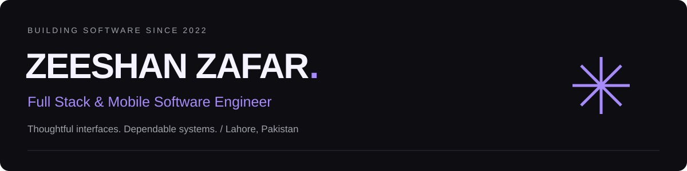
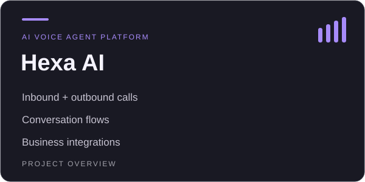
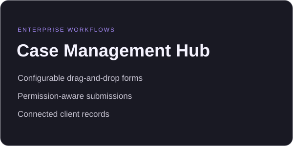
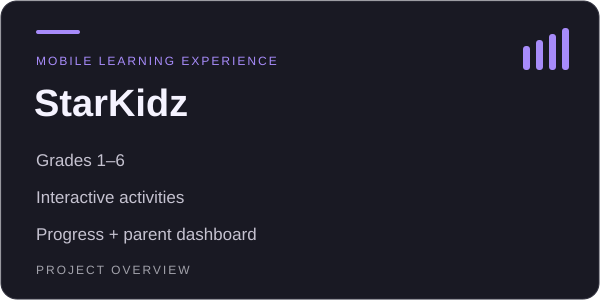
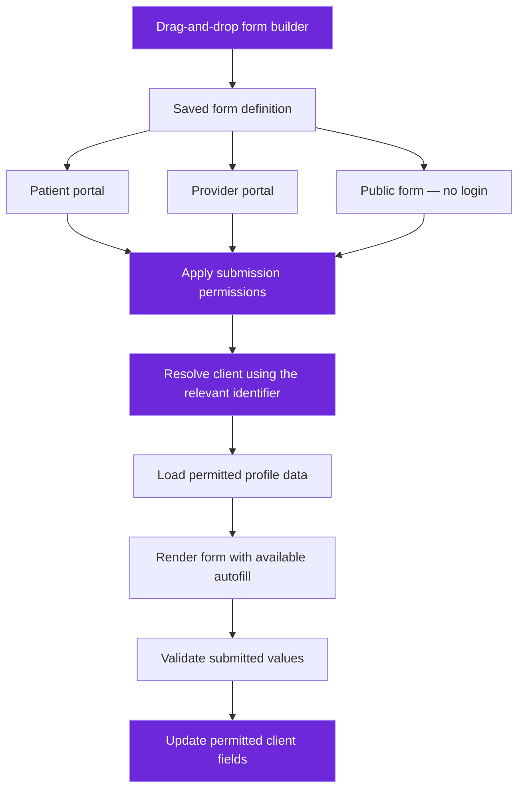

<picture>
  <source media="(prefers-color-scheme: dark)" srcset="assets/header.svg" />
  <source media="(prefers-color-scheme: light)" srcset="assets/header-light.svg" />
  
</picture>

### I turn complex ideas into dependable software.

Thoughtful interfaces. Maintainable backends. Mobile experiences built with care.

[Projects](#selected-work) · [Engineering](#how-i-build) · [Stack](#tech-stack) · [Experience](#experience) · [Contact](#lets-connect)

---

## About me

**Curious by nature. Engineer by craft.**

I’m a **Full Stack & Mobile Software Engineer** based in Lahore, Pakistan, building software professionally since **2022**.

My work connects product thinking with maintainable architecture—from API and database design to web interfaces and mobile releases.

- **Web:** React, Next.js, TypeScript, and reusable interfaces.
- **Backend:** Node.js, NestJS, Hono, API design, and database workflows.
- **Mobile:** React Native, Expo, Kotlin, and Jetpack Compose.
- **Product experience:** Enterprise platforms, healthcare, AI voice applications, fintech, and education.

I’ve contributed to **50+ projects**, ranging from individual features to complete products. Some work remains private under NDAs; the projects below represent work I can share publicly.

---

## Selected work

### Hexa AI
**Real-time voice AI · Full-stack development**

A multi-tenant platform for configuring AI voice agents, conversation flows, and calling workflows.

**My work**
- Built visual conversation-flow interfaces and backend integrations.
- Designed real-time voice orchestration connecting telephony, speech recognition, AI models, and speech synthesis.
- Connected company-scoped calling workflows and administrative access.

**Stack:** Next.js · NestJS · React Flow · PostgreSQL · Twilio · OpenAI · ElevenLabs

[Engineering case study ↗](https://zeeshan-zafar.vercel.app/projects/hexa-ai) · [Live product ↗](https://gethexa.ai/)

---

### Case Management Hub
**Enterprise workflows · Full-stack development**

A platform connecting client records, configurable forms, scheduling, reporting, and service operations.

**My work**
- Built configurable drag-and-drop forms.
- Connected submissions to client-profile updates using three identification paths.
- Handled permissions across patient, provider, and public form submissions.
- Supported autofill from existing client-profile data.

**Stack:** Next.js · TypeScript · NestJS · PostgreSQL

[Engineering case study ↗](https://zeeshan-zafar.vercel.app/projects/case-management) · [Product website ↗](https://casemanagementhub.org/) · [Portal ↗](https://app.casemanagementhub.org/)

---

### StarKidz
**Published mobile learning app · Formerly Nedjmati**

A learning application with dynamic subjects, units, lessons, questions, and multilingual experiences.

**My work**
- Built mobile interfaces driven by backend learning content.
- Developed and maintained data-seeding scripts for source material supplied in different formats.
- Handled content-version updates and language changes throughout the app.
- Connected learning sessions, audio, and progress tracking.

**Stack:** React Native · Expo · TypeScript · Firebase · PostgreSQL

[Engineering case study ↗](https://zeeshan-zafar.vercel.app/projects/nedjmati) · [Google Play ↗](https://play.google.com/store/apps/details?id=com.nedjmati.nedjmatiapp)

Download count describes the app’s public reach, rather than a measured result attributable to one engineering change.

<strong>More projects</strong>

 

| Project | Focus | Core technologies |
|---|---|---|
| **[Homewellness](https://zeeshan-zafar.vercel.app/projects/homewellness)** | Healthcare marketplace with service requests, quotations, appointments, and provider workflows | Next.js, Hono, Bun, Drizzle ORM, PostgreSQL |
| **[Degn](https://degn.app/)** | Native Android fintech application with market charts, payment integrations, and secure authentication | Kotlin, Jetpack Compose, Firebase |
| **[GOAT App](https://apps.apple.com/us/app/goat-app/id1597319742)** | Reservation workflows, synchronized availability, Firebase query improvements, and React Native upgrades | React Native, Firebase, JavaScript |

[Explore all projects ↗](https://zeeshan-zafar.vercel.app/projects)

---

## How I build

I care about how a product works—and how it feels to use.

One example is **Case Management Hub’s form system**. The challenge extended beyond drag-and-drop editing: submissions needed to identify the correct client, respect permissions, prefill existing information, and update the appropriate profile data.

**My approach**
- Understand the workflow before choosing the implementation.
- Keep interfaces, API contracts, and data models aligned.
- Make permission boundaries explicit.
- Build reusable components where they simplify the product.
- Validate important paths and keep the code understandable as it grows.

---

## Tech stack

| Area | Technologies |
|---|---|
| **Web** | React · Next.js · TypeScript · Tailwind CSS |
| **Mobile** | React Native · Expo · Kotlin · Jetpack Compose · Android · iOS |
| **Backend** | Node.js · NestJS · Express · Hono · Bun · FastAPI |
| **Data** | PostgreSQL · MySQL · MongoDB · Firebase · Supabase · SQL Server |
| **ORMs** | Prisma · Drizzle ORM |
| **Tools** | Git · Docker · Bash · Kafka |
| **Integrations** | OpenAI · ElevenLabs · Twilio · Stripe · Firebase Cloud Messaging · MoonPay · TransFi |

<strong>Additional languages</strong>

JavaScript · Java · Python · C++ · C · PHP · HTML · CSS

---

## Experience

| Role | Company | Period |
|---|---|---|
| **Software Engineer / Full-Stack Developer** | Verdant Soft · Lahore | Jan 2026 – Present |
| **Software Engineer** | TheDesignerX · Lahore | Jul 2022 – Dec 2025 |

<strong>What I worked on</strong>

 

**Verdant Soft**
- Full-stack web applications and backend services.
- AI calling platforms, healthcare workflows, and mobile learning products.
- Reusable interfaces, third-party integrations, and connected data workflows.

**TheDesignerX**
- Enterprise workflow applications.
- Native Android applications for industrial operations.
- React Native applications for eCommerce and fundraising.
- Node.js and Firebase serverless integrations.

**Education:** BS Computer Science · COMSATS University Islamabad, Lahore Campus

---

## GitHub activity

My contributions are spread across **[ZeeshiCh](https://github.com/ZeeshiCh)** and my professional account, **[zeeshanzafarvs](https://github.com/zeeshanzafarvs)**. Public repository activity represents only part of my engineering work.

<strong>View public GitHub statistics</strong>

 

<picture>
  <source media="(prefers-color-scheme: dark)" srcset="https://github-readme-stats.vercel.app/api?username=ZeeshiCh&amp;show_icons=true&amp;hide_border=true&amp;bg_color=191923&amp;title_color=A78BFA&amp;icon_color=A78BFA&amp;text_color=F5F3FF" />
  <source media="(prefers-color-scheme: light)" srcset="https://github-readme-stats.vercel.app/api?username=ZeeshiCh&amp;show_icons=true&amp;hide_border=true&amp;bg_color=F7F5F0&amp;title_color=6D28D9&amp;icon_color=6D28D9&amp;text_color=24212B" />
  
</picture>

<strong>Contribution animation</strong>

 

<picture>
  <source media="(prefers-color-scheme: dark)" srcset="https://raw.githubusercontent.com/ZeeshiCh/ZeeshiCh/output/github-snake-dark.svg" />
  <source media="(prefers-color-scheme: light)" srcset="https://raw.githubusercontent.com/ZeeshiCh/ZeeshiCh/output/github-snake.svg" />
  
</picture>

---

## Let’s connect

Have a web, backend, or mobile product to build—or an engineering role to discuss?

**[Explore my portfolio ↗](https://zeeshan-zafar.vercel.app/)** · **[Download résumé ↓](https://zeeshan-zafar.vercel.app/assets/zeeshan-zafar-cv.pdf)** · **[Book a 30-minute call ↗](https://calendly.com/zeeshich019/30min)**

[LinkedIn](https://www.linkedin.com/in/zeeshi-ch/) · [Zeeshich019@gmail.com](mailto:Zeeshich019@gmail.com) · [+92 333 606 0197](tel:+923336060197)

Built with intention. From Lahore, Pakistan.
