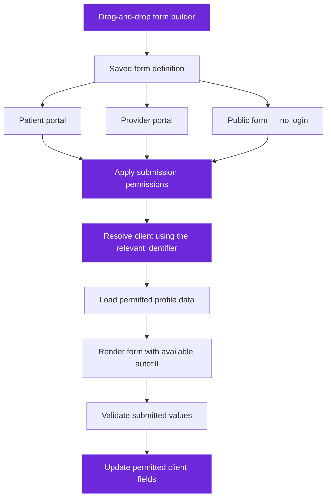

<div align="center">

<picture>
  <source media="(prefers-color-scheme: dark)" srcset="https://capsule-render.vercel.app/api?type=waving&amp;color=0:191923,50:6D28D9,100:A78BFA&amp;height=220&amp;section=header&amp;text=Zeeshan%20Zafar&amp;fontSize=48&amp;fontColor=F5F3FF&amp;animation=fadeIn&amp;fontAlignY=36&amp;desc=Full%20Stack%20%2B%20Mobile%20Software%20Engineer&amp;descAlignY=58&amp;descSize=18" />
  <source media="(prefers-color-scheme: light)" srcset="https://capsule-render.vercel.app/api?type=waving&amp;color=0:EDE9F5,50:DDD6FE,100:C4B5FD&amp;height=220&amp;section=header&amp;text=Zeeshan%20Zafar&amp;fontSize=48&amp;fontColor=4C1D95&amp;animation=fadeIn&amp;fontAlignY=36&amp;desc=Full%20Stack%20%2B%20Mobile%20Software%20Engineer&amp;descAlignY=58&amp;descSize=18" />
  
</picture>

### I turn complex ideas into dependable software.

Thoughtful interfaces. Maintainable backends. Mobile experiences built with care.

[](https://zeeshan-zafar.vercel.app/)
[](https://www.linkedin.com/in/zeeshi-ch/)
[](mailto:Zeeshich019@gmail.com)
[](https://calendly.com/zeeshich019/30min)


[Projects](#selected-work) · [Engineering](#how-i-build) · [Stack](#tech-stack) · [Experience](#experience) · [Contact](#lets-connect)

</div>

---

<a id="about-me"></a>

## 👋 About Me

<table>
<tr>
<td width="55%" valign="top">

I’m a **Full Stack & Mobile Software Engineer** who cares about how a product works—and how it feels to use.

For **4+ years**, I’ve built web, backend, and mobile experiences across **enterprise software, healthcare, fintech, education, and AI voice applications**.

- 🔭 Working on **full-stack platforms and mobile products** at Verdant Soft.
- 📱 Building with **React Native, Kotlin, Next.js, and NestJS**.
- 💬 Ask me about **API design, dynamic forms, mobile workflows, and integrations**.
- ⚡ Contributed to **50+ projects**, from individual features to complete products. Some work remains private under NDAs.

</td>
<td width="45%" valign="top">

```ts
// whoami.ts
const zeeshan = {
  role: "Full Stack & Mobile Engineer",
  company: "Verdant Soft",
  based: "Lahore, Pakistan 🇵🇰",
  buildingSince: 2022,
  degree: "BS CS · COMSATS Lahore",
  focus: ["Software Architecture", "Product Leadership"],
  stack: {
    web: ["React", "Next.js", "TypeScript"],
    backend: ["Node.js", "NestJS", "Hono"],
    mobile: ["React Native", "Kotlin"],
  },
  coffee: Infinity,
};
```

</td>
</tr>
</table>

---

## Selected work

A few products I’ve built across web, backend, and mobile. Explore the case studies for the engineering behind them.

<table>
<tr>
<td width="50%" valign="top">

### 📞 Hexa AI
**AI voice platform**

Built visual conversation flows and connected real-time calling workflows across telephony, speech recognition, AI models, and voice synthesis.

`Next.js` `NestJS` `React Flow` `PostgreSQL`

[Case study ↗](https://zeeshan-zafar.vercel.app/projects/hexa-ai) · [Live product ↗](https://gethexa.ai/)

</td>
<td width="50%" valign="top">

### 🗂️ Case Management Hub
**Enterprise workflow platform**

Built configurable drag-and-drop forms, permission-aware submissions, and client-profile updates across patient, provider, and public workflows.

`Next.js` `TypeScript` `NestJS` `PostgreSQL`

[Case study ↗](https://zeeshan-zafar.vercel.app/projects/case-management) · [Website ↗](https://casemanagementhub.org/) · [Portal ↗](https://app.casemanagementhub.org/)

</td>
</tr>
<tr>
<td width="50%" valign="top">

### 🎒 StarKidz
**Mobile learning · Formerly Nedjmati**

Built dynamic learning interfaces, multilingual experiences, and scripts that transform varied source material into versioned learning content.

`React Native` `Expo` `TypeScript` `PostgreSQL`

**50K+ Google Play downloads** — app reach, not a measured result of an individual engineering change.

[Case study ↗](https://zeeshan-zafar.vercel.app/projects/nedjmati) · [Google Play ↗](https://play.google.com/store/apps/details?id=com.nedjmati.nedjmatiapp)

</td>
<td width="50%" valign="top">

### 🩺 Homewellness
**Healthcare marketplace**

Built connected service-request, quotation, appointment, and provider workflows for patients and healthcare professionals.

`Next.js` `Hono` `Bun` `Drizzle` `PostgreSQL`

[Case study ↗](https://zeeshan-zafar.vercel.app/projects/homewellness) · [Live app ↗](https://app.homewellnessplus.com/)

</td>
</tr>
</table>

<details>
<summary><strong>More projects</strong></summary>

<br />

| Project | Focus | Stack |
|---|---|---|
| **[Degn](https://degn.app/)** | Native Android fintech application with market charts, payments, and secure authentication | Kotlin · Jetpack Compose · Firebase |
| **[GOAT App](https://apps.apple.com/us/app/goat-app/id1597319742)** | Reservation workflows, synchronized availability, Firebase queries, and React Native upgrades | React Native · Firebase · JavaScript |

</details>

**[Explore all projects on my portfolio ↗](https://zeeshan-zafar.vercel.app/projects)**

---

## How I build

I care about how a product works—and how it feels to use.

One example is **Case Management Hub’s form system**. The challenge extended beyond drag-and-drop editing: submissions needed to identify the correct client, respect permissions, prefill existing information, and update the appropriate profile data.

<details>
<summary><strong>View the form-workflow architecture</strong></summary>



</details>

**My approach**
- Understand the workflow before choosing the implementation.
- Keep interfaces, API contracts, and data models aligned.
- Make permission boundaries explicit.
- Build reusable components where they simplify the product.
- Validate important paths and keep the code understandable as it grows.

---

<a id="tech-stack"></a>

## 🛠️ Tech Stack

**Languages**

<p>
  
  
  
  
  
  
  
  
  
  
</p>

**Frontend & Mobile**

<p>
  
  
  
  
  
  
  
  
</p>

**Backend**

<p>
  
  
  
  
  
  
  
</p>

**Databases**

<p>
  
  
  
  
  
  
</p>

**DevOps & Tools**

<p>
  
  
  
  
  
</p>

**AI & Integrations**

<p>
  
  
  
  
  
  
</p>

---

## Experience

| Role | Company | Period |
|---|---|---|
| **Software Engineer / Full-Stack Developer** | Verdant Soft · Lahore | Jan 2026 – Present |
| **Software Engineer** | TheDesignerX · Lahore | Jul 2022 – Dec 2025 |

<details>
<summary><strong>What I worked on</strong></summary>

<br />

**Verdant Soft**
- Full-stack web applications and backend services.
- AI calling platforms, healthcare workflows, and mobile learning products.
- Reusable interfaces, third-party integrations, and connected data workflows.

**TheDesignerX**
- Enterprise workflow applications.
- Native Android applications for industrial operations.
- React Native applications for eCommerce and fundraising.
- Node.js and Firebase serverless integrations.

</details>

**Education:** BS Computer Science · COMSATS University Islamabad, Lahore Campus

---

## GitHub activity

My contributions are spread across **[ZeeshiCh](https://github.com/ZeeshiCh)** and my professional account, **[zeeshanzafarvs](https://github.com/zeeshanzafarvs)**. Public repository activity represents only part of my engineering work.

<details>
<summary><strong>View public GitHub statistics</strong></summary>

<br />

<picture>
  <source media="(prefers-color-scheme: dark)" srcset="https://github-readme-stats.vercel.app/api?username=ZeeshiCh&amp;show_icons=true&amp;hide_border=true&amp;bg_color=191923&amp;title_color=A78BFA&amp;icon_color=A78BFA&amp;text_color=F5F3FF" />
  <source media="(prefers-color-scheme: light)" srcset="https://github-readme-stats.vercel.app/api?username=ZeeshiCh&amp;show_icons=true&amp;hide_border=true&amp;bg_color=F7F5F0&amp;title_color=6D28D9&amp;icon_color=6D28D9&amp;text_color=24212B" />
  
</picture>

</details>

<details>
<summary><strong>Contribution animation</strong></summary>

<br />

<picture>
  <source media="(prefers-color-scheme: dark)" srcset="https://raw.githubusercontent.com/ZeeshiCh/ZeeshiCh/output/github-snake-dark.svg" />
  <source media="(prefers-color-scheme: light)" srcset="https://raw.githubusercontent.com/ZeeshiCh/ZeeshiCh/output/github-snake.svg" />
  
</picture>

</details>

---

<a id="lets-connect"></a>

## Let’s connect

Have a web, backend, or mobile product to build—or an engineering role to discuss?

**[Explore my portfolio ↗](https://zeeshan-zafar.vercel.app/)** · **[Download résumé ↓](https://zeeshan-zafar.vercel.app/assets/zeeshan-zafar-cv.pdf)** · **[Book a 30-minute call ↗](https://calendly.com/zeeshich019/30min)**

[LinkedIn](https://www.linkedin.com/in/zeeshi-ch/) · [Zeeshich019@gmail.com](mailto:Zeeshich019@gmail.com) · [+92 333 606 0197](tel:+923336060197)

<sub>Built with intention. From Lahore, Pakistan.</sub>

<picture>
  <source media="(prefers-color-scheme: light)" srcset="https://capsule-render.vercel.app/api?type=waving&amp;color=0:C4B5FD,50:DDD6FE,100:EDE9F5&amp;height=110&amp;section=footer" />
  
</picture>
